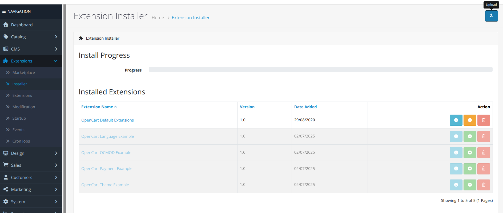
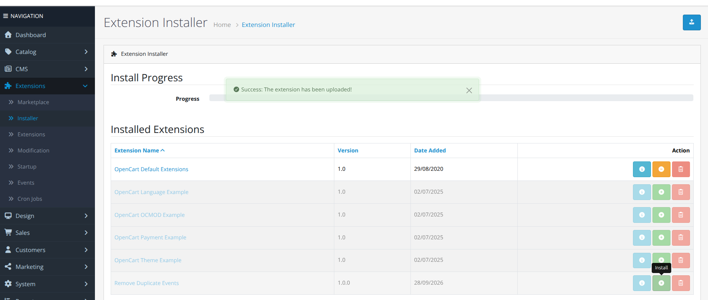
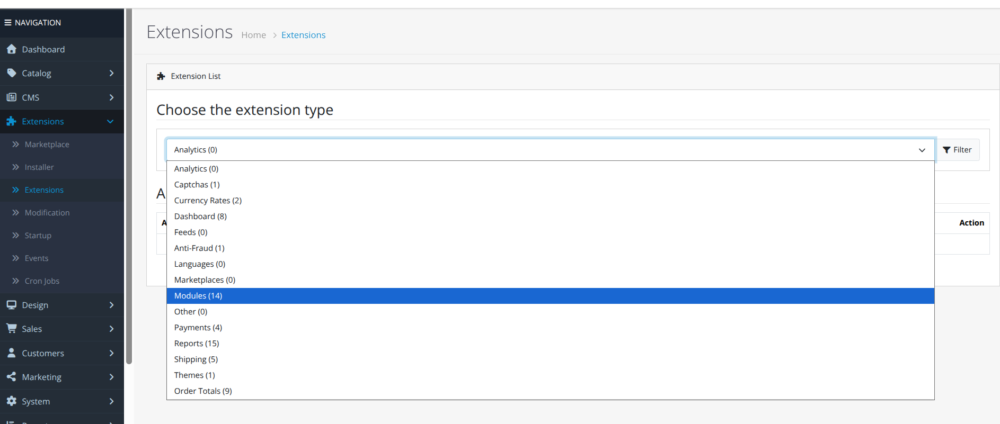
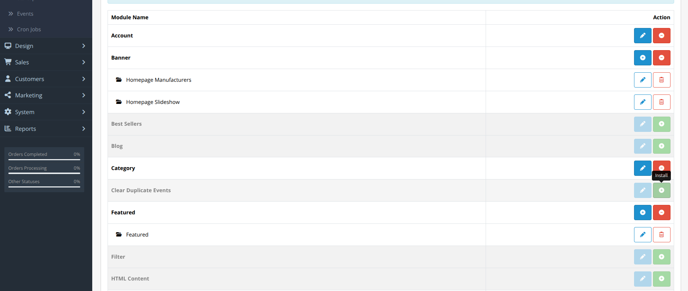
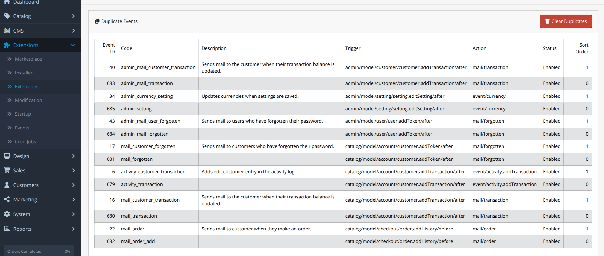
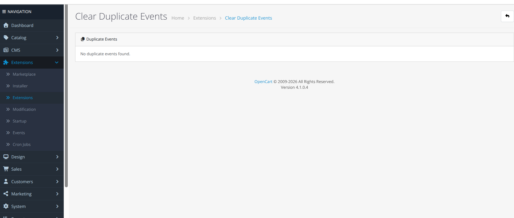

# Clear duplicate events after Opencart upgrade

After upgrade to OC 4.1.0.4 there are duplicate trigger+action events created, like sending customer email on new order, so they receive the same email twice.
This simple extension clears the newly created duplicate.

# ALWAYS CREATE BACKUP BEFORE INSTALLING AND RUNNING EXTENSIONS

# How to install and run
Go to Extensions > Installer > click on **Upload** > select the **remove_duplicate_events.ocmod.zip**


Click the green **Install** button


Go to Extensions > Extensions > select from dropdown **Modules**


Find ```Clear Duplicate Events``` > click **Install** > click **Edit**


If any duplicate events are found they are displayed in the table, where gray is the newer event and will be removed when ```Clear Duplicates``` button is pressed


